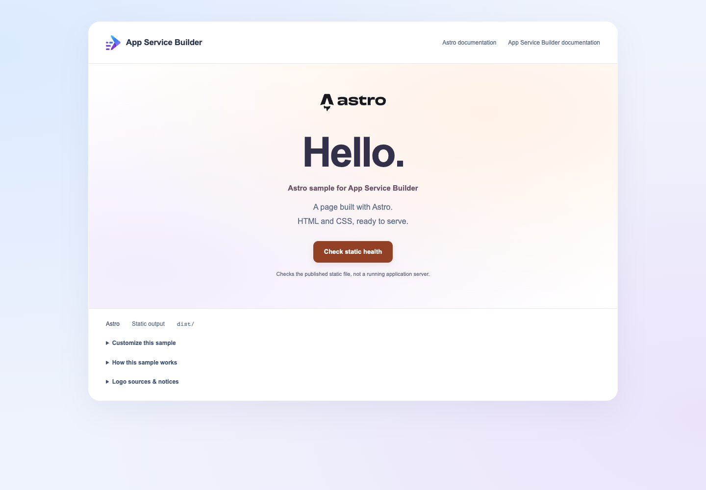

# Astro sample for App Service Builder

A minimal hello-world page built with Astro and served as static HTML at `/`.
No backend, external services, counters, or credentials are required.



Screenshot: the production build rendered locally in Microsoft Edge, not proof of a hosted deployment.

## Deploy to Builder

1. Fork this repository.
2. Create a Builder App using your authorized fork and the root `builder.yaml`.
3. Deploy the app, then open its root URL.

The manifest uses Node.js 24 to build the `site` component and publishes `dist/`
as static output. It does not start an Astro server.
See [App Service Builder documentation](https://builder.appservice.azure.com/docs/)
for the current source and deployment workflow.

## Customize

Edit the greeting in `src/pages/index.astro` and styles in `src/styles/sample.css`.
Commit to your fork, then deploy the updated source through your Builder App.
There are no runtime variables to set for this static greeting.

**Check static health** reads `/health` inline. Failure leaves an enabled retry button.
A successful response verifies that a static file is served; it does not establish
application-server or external-service readiness.

## Run locally

Use Node.js 24.15.0 or later:

```sh
npm ci --ignore-scripts
npm run build
npm test
npm run preview -- --host 127.0.0.1
```

Open the URL printed by Astro. Stop the preview with Ctrl+C.

## Learn more

- [Astro documentation](https://docs.astro.build/)
- [App Service Builder documentation](https://builder.appservice.azure.com/docs/)
- [Logo sources and usage notices](public/assets/NOTICE.md)

The supplied Builder mark and official Astro logo are stored locally. No external
fonts, scripts, telemetry, or logo downloads are needed to render the page.
